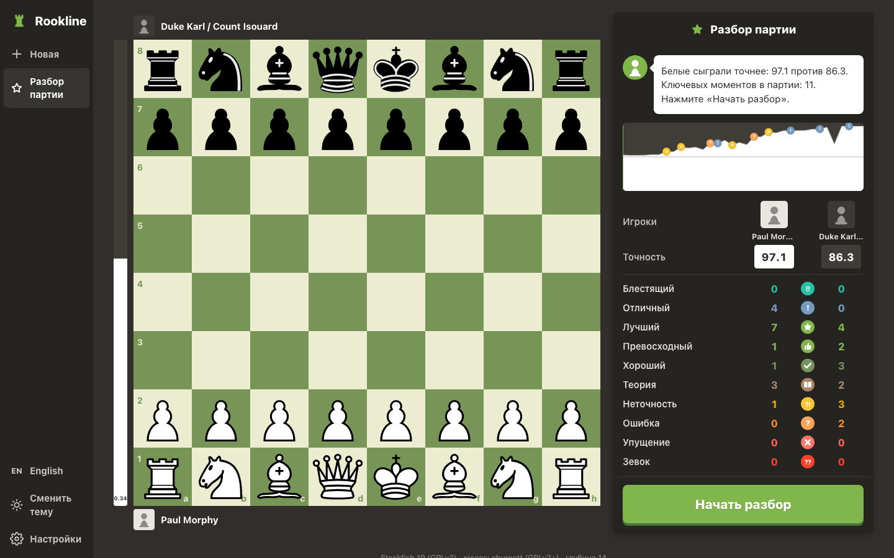
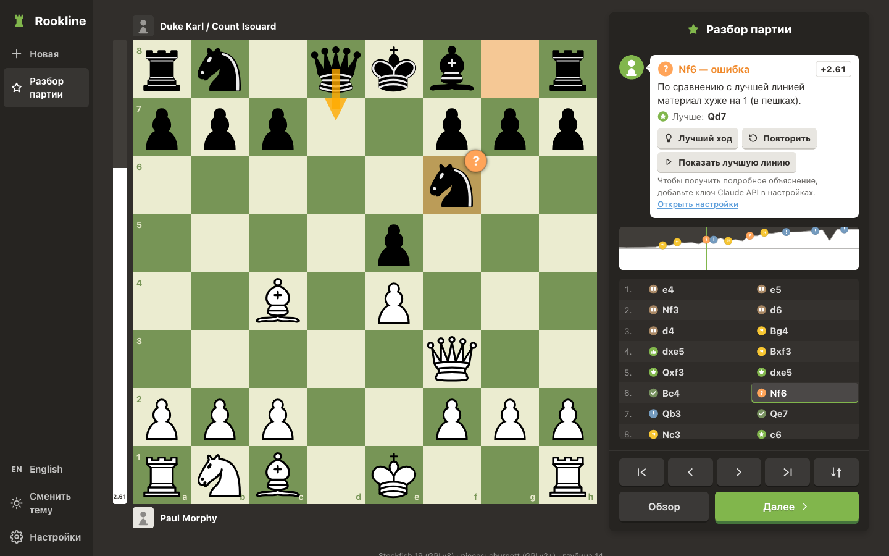

# Rookline — разбор шахматной партии в браузере

Статическое веб-приложение: загружаете партию, Stockfish анализирует её прямо в браузере (Web Worker, без сервера), и вы получаете отчёт: категория каждого хода, точность (accuracy) обоих игроков, график оценки, доска с навигацией и комментарии к ходам на русском или английском.





## Возможности

- **Четыре способа загрузки:** вставить PGN; файл `.pgn` (несколько партий, выбор из списка, битые помечены); последние партии по нику chess.com (месяц за месяцем, кнопка «Ещё месяц»); последние 20 партий по нику Lichess.
- **Анализ:** Stockfish 19 lite single-threaded (WASM) в Web Worker, MultiPV 2, глубина 16 по умолчанию (8–22 в настройках), прогресс-бар и отмена. Мат и пат считаются без движка. Результаты кэшируются в IndexedDB по хэшу ходов и глубине.
- **Классификация:** Best, Excellent, Good, Inaccuracy, Mistake, Blunder + особые метки Book, Great, Brilliant, Miss. Все пороги в одном файле `src/analysis/config.ts`.
- **Accuracy, подогнанная под chess.com:** формула подобрана на 110 публичных партиях с точностью от chess.com (220 игроков, рейтинг 200–3300, глубина 16). Средняя ошибка 3.9 пункта (формула Lichess — 8.0, простое среднее из первой версии — 16.5).
- **Рейтинг игры (примерный)** по точности и Эло игроков; **оценки дебюта, миттельшпиля и эндшпиля** (точность в каждой стадии и значок); **Book** по дебютной книге lichess (CC0, 3864 названных позиции) и название дебюта.
- **Отчёт в привычной раскладке шахматных сайтов:** тёмная тема, зелёная доска, слева шкала оценки, над и под доской игроки; справа панель «Разбор партии». Сначала сводка (тренер, график, точность, счётчики категорий, рейтинг игры, оценки стадий, название дебюта) и большая кнопка «Начать разбор», затем «Далее» по ключевым ходам. В пузыре тренера: «Ход — ошибка», оценка, лучший ход, кнопки «Лучший ход», «Повторить» (найти ход самому, кликом по доске), «Показать лучшую линию», «Объяснить подробнее». Клетки хода подсвечены цветом категории. Клавиши ← → ↑ ↓ (Home/End), `f` — перевернуть.
- **Комментарии:** офлайн-шаблоны RU/EN (мат упущен/допущен, фигура под боем, потеря материала, упущенное взятие или шах, позиционная потеря), по несколько вариантов фраз. По кнопке «Объяснить подробнее» — объяснение от Claude (нужен ваш ключ API).
- Светлая и тёмная тема, русский и английский, телефон и компьютер.

## Запуск

Нужен Node.js 20+.

```bash
npm install        # postinstall копирует Stockfish в public/engine
npm run dev        # http://localhost:5173
```

На macOS проще всего — двойной щелчок по `Rookline.app` (лежит рядом с папкой проекта) или по `Rookline — запустить.command`. Оба вызывают `scripts/serve.sh`: при необходимости собирают приложение, запускают локальный сервер **в фоне** (порт 5188, окно Терминала не нужно) и открывают браузер. Движок загружается сразу при открытии страницы, так что анализ работает, даже если сервер потом остановить. Остановить сервер: `pkill -f "preview --port 5188"`.

Для проверки с готовой партией: `http://localhost:5173/#sample` (Opera Game, Морфи, 1858).

## Сборка и тесты

```bash
npm run build         # tsc + vite build → dist/
npm run preview       # посмотреть сборку
npm test              # юнит-тесты (Vitest)
npm run test:engine   # интеграционные тесты на настоящем Stockfish (Node)
npm run test:all
```

Юнит-тесты: перевод cp → win%, пороги классификации и особые метки, формула accuracy, кодирование мата, разбор PGN с несколькими партиями, импорт chess.com / Lichess (с подменой fetch), запрос к Claude API, словари i18n и шаблоны комментариев, кэш IndexedDB.

Интеграционные (на движке): оценка стартовой позиции; прогресс и отмена анализа; зевок ферзя (`3.Qxe5+?? Nxe5`) получает Blunder и комментарий «ферзь под боем»; мат Легаля — `5...Bxd1??` получает Blunder и комментарий «мат в 2».

## Сайт и деплой на GitHub Pages

Сайт: **https://kainar24.github.io/rookline/** (репозиторий [kainar24/rookline](https://github.com/kainar24/rookline)).

`vite.config.ts` использует `base: './'`, поэтому сборка работает и в корне домена, и в подпапке `/<repo>/`. Stockfish лежит рядом (`dist/engine/`) и грузится с того же адреса: кросс-доменный воркер браузер бы заблокировал. Однопоточной lite-сборке не нужны заголовки COOP/COEP, поэтому GitHub Pages подходит без настроек.

Публикация автоматическая: при каждом push в `main` GitHub Actions (`.github/workflows/pages.yml`) ставит зависимости, гоняет юнит-тесты и тесты на движке, собирает `dist/` и выкладывает его на Pages. Ход сборки виден во вкладке Actions репозитория.

```bash
bash deploy-site.sh   # локальные тесты → git push origin main → Actions публикует сайт
```

Вручную без GitHub: `npm run build` и выложить содержимое `dist/` на любой статический хостинг (сервер должен отдавать `.wasm` как `application/wasm`).

## Claude API (необязательно)

В настройках можно указать ключ Claude API и модель (по умолчанию `claude-sonnet-5-5`). Ключ хранится только в `localStorage` этого браузера и отправляется только в `https://api.anthropic.com/v1/messages` заголовком `x-api-key` (плюс `anthropic-version: 2023-06-01` и `anthropic-dangerous-direct-browser-access: true`). В запрос попадают только факты движка: FEN до хода, сыгранный ход, лучший ход и линия, оценки до и после, категория, язык. Системный промпт просит объяснить как тренер, в 2–4 предложениях, опираясь только на эти данные. Для моделей, которые это поддерживают, включён серверный запасной вариант (`fallbacks: "default"`): если модель откажется отвечать, API сам повторит запрос на запасной модели. Без ключа кнопка скрыта, вместо неё подсказка открыть настройки.

Учтите: ключ в браузере видит любой, у кого есть доступ к этому браузеру. Не используйте приложение с чужого компьютера с вашим ключом.

## Устройство кода

```
src/
  analysis/   config.ts (все пороги), evalMath.ts (win%, accuracy, мат), classify.ts,
              material.ts (жертвы, висящие фигуры), analyzer.ts, terminal.ts
  engine/     uci.ts (парсер info/bestmove), uciEngine.ts (UCI-драйвер), workerEngine.ts
  pgn/        pgn.ts (несколько партий, FEN, хэш)
  importers/  importers.ts (chess.com, Lichess)
  comments/   reasons.ts (причина по данным движка), templates.ts (тексты)
  llm/        claude.ts
  i18n/       ru.ts, en.ts (все строки интерфейса и фраз)
  cache/      idbCache.ts
  ui/         board.ts, chart.ts, report.ts, input.ts, settingsDialog.ts, icons.ts
tests/unit, tests/engine
docs/         скриншоты
```

Рейтинг игры — `src/analysis/rating.ts`: на chess.com точность растёт примерно как `11.5·ln(рейтинг) − 7.46`; если сыграно точнее ожидаемого для своего Эло, оценка выше Эло (с поправкой 0.6, потому что одна партия — шумная выборка). Это приближение, у chess.com формула закрытая.

### Как работает модель

- Оценка хранится с точки зрения белых в сантипешках, мат в N — `±(10000 − N)`.
- `win% = 50 + 50 · (2 / (1 + e^(−0.00368208 · cp)) − 1)`.
- `loss = win%_до − win%_после` для ходившего; если сыгран первый ход движка, loss = 0.
- Точность хода: `103.1669·e^(−0.09·loss) − 3.1669`, где loss считается по более пологой кривой (`k = 0.002`). Точность игрока — гармоническое среднее точностей ходов (каждая не ниже 23). Константы в `CONFIG.accuracy`.
- Стадии: миттельшпиль, когда после книги осталось ≤ 10 лёгких и тяжёлых фигур, или на последней горизонтали у кого-то < 4 фигур, или прошло 30 полуходов; эндшпиль при ≤ 6 фигурах.
- Book — позиция после хода есть в дебютной книге (подряд с начала партии; `npm`-скрипт `node scripts/build-openings.mjs` пересобирает `src/analysis/openings.json` из `data/openings`). Без книги — пока ply ≤ 10 и loss ≤ 2. Любой мат — Best. Great — лучший ход и разрыв с 2-й линией ≥ 10 (кроме очевидного взятия обратно и мата в 1). Brilliant — loss ≤ 2, ходившая фигура ценой ≥ 3 под невыгодным боем, после хода win% ≥ 45, до хода < 80. Miss — соперник только что сделал Mistake/Blunder, а ход теряет ≥ 10 при лучшем варианте ≥ 70 и всё ещё не проигрывает.
- Потеря материала в комментариях считается по концу линий движка (с доигрыванием разменов) и ограничивается падением оценки движка, чтобы не преувеличивать.

## Лицензии

- **Stockfish** — GPLv3 (© авторы Stockfish; WASM-сборка stockfish.js, Nathan Rugg и др.). Текст лицензии копируется в `public/engine/COPYING.txt` и попадает в сборку.
- **Фигуры cburnett** — Colin M.L. Burnett, GPLv2+ (взяты из репозитория lichess-org/lila, `public/piece/cburnett`).
- **Дебютная книга** — lichess-org/chess-openings, CC0 (`data/openings`).
- Идея формулы точности (гармоническое и взвешенное среднее) — из lichess; оценки по стадиям — по идее «divider» lichess; код написан заново.
- Код этого приложения — GPL-3.0-or-later (так как в сборку входит Stockfish).
- Раскладка и палитра повторяют привычный вид экранов разбора на шахматных сайтах, но значки, аватары и логотип нарисованы заново, названий и логотипов chess.com в приложении нет. Это независимый проект, не связанный с chess.com или Lichess.
